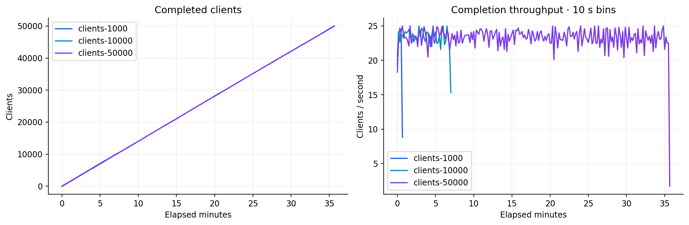
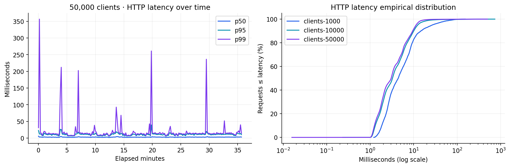
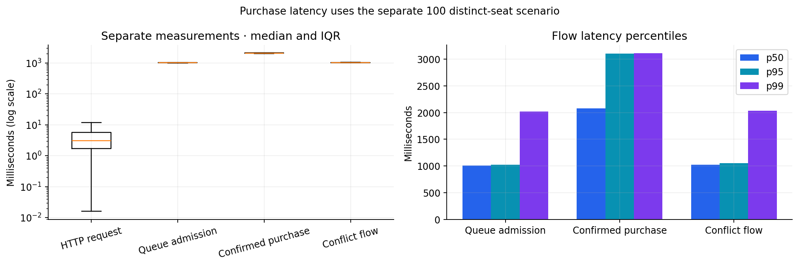
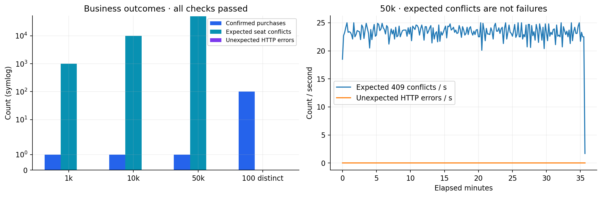
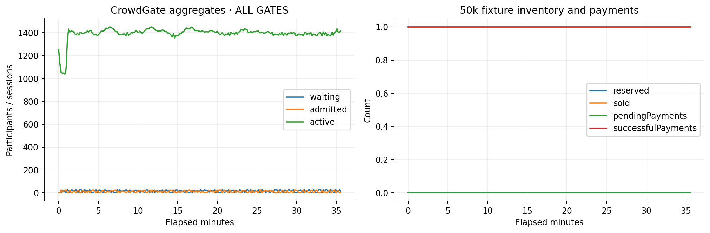
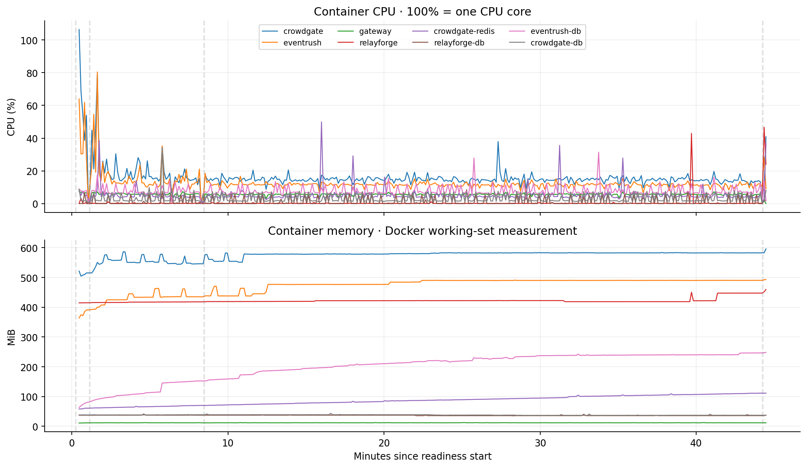
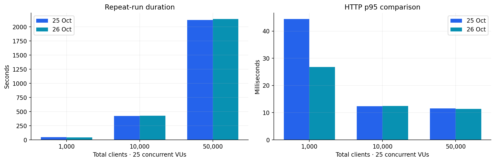
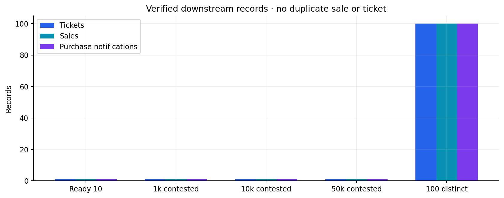

# EventRush

Concert ticket sales under concurrent demand. EventRush handles seat reservations, simulated payments and purchase records. CrowdGate controls admission; RelayForge delivers purchase events to ticketing, accounting and notification handlers.

## Features

- Concert and seat management, sale opening and availability checks.
- Atomic seat reservations with a five-minute TTL, cancellation and automatic expiry.
- Simulated successful, failed and delayed payments.
- Database constraints and transaction locks that prevent double booking and double selling.
- Durable outgoing events written in the same transaction as the purchase.
- Signed webhook processing with deduplication, numbered tickets, sales accounting and simulated notifications.
- Administrative statistics and searchable participant activity with cursor pagination.
- CSV import for up to 50,000 test participants, with seat validation and bounded input size.
- A plain HTML, CSS and JavaScript interface for testing the purchase flow.

## Stack

- Java 21, Spring Boot 3, Spring MVC
- PostgreSQL, Spring Data JPA, JdbcTemplate, Flyway
- Maven
- Docker Compose, Nginx
- HTML, CSS, JavaScript
- JUnit 5, Mockito, Testcontainers

Redis belongs to CrowdGate. EventRush stores its transaction data in PostgreSQL.

## Services

**EventRush** owns concerts, seats, reservations and payments. Competing reservations use conditional database updates and a unique constraint on active or confirmed reservations for each seat. Payment, cancellation and expiry follow a consistent lock order.

**[CrowdGate](https://github.com/lazorenkoo/crowdgate-virtual-waiting-room)** provides the waiting room and admission tokens. EventRush verifies admission over HTTP and binds purchases to an opaque session cookie.

**[RelayForge](https://github.com/lazorenkoo/Reliable-Webhook-Delivery-Platform)** handles webhook delivery and retries. EventRush publishes through a transactional outbox with stable idempotency keys. Receivers verify signatures and deduplicate events, so delivery retries cannot create duplicate tickets or sales records.

Each service has its own database. Integration sources are pinned as Git submodules.

## Run locally

Requires Git, Docker Compose and PowerShell 7.

```powershell
git clone --recurse-submodules https://github.com/lazorenkoo/eventRush-high-load-ticketing.git
cd eventRush-high-load-ticketing
pwsh ./scripts/demo.ps1
```

The script generates local credentials in `.env`, builds the services, configures webhook subscriptions and creates sample concert data.

- Purchase interface: http://localhost:8082
- Administrative statistics: http://localhost:8082/admin.html

Use `EVENTRUSH_ADMIN_API_KEY` from the local `.env` for administrative access. Keep this file private.

To stop the stack while keeping its data:

```shell
docker compose down
```

## Tests

Requires Java 21, Maven and Docker for PostgreSQL integration tests.

```shell
mvn verify
```

Tests cover concurrent reservations, payment and expiry races, transaction rollback, session ownership, webhook deduplication, CSV validation and bounded buyer execution.

### Load test results · 26 October 2026

Real authenticated HTTP runs completed with 1,000, 10,000 and 50,000 clients at **25 concurrent virtual users**. All checks and database invariants passed, with no unexpected HTTP errors or double sales. The 50,000-client run took **35m 40s**, with HTTP **p95 11.36 ms** and **p99 15.88 ms**.

The contention runs targeted one seat: one purchase and the remaining attempts received expected seat conflicts. A separate 100-seat scenario confirmed **100 purchases, tickets, sales entries and notifications**.

Test configuration: CrowdGate admission 25/s, 2,000 active sessions, 60 s session TTL; shared-IP request limits temporarily raised to 200/s with a burst of 400, then restored. These results describe 50,000 total clients, not simultaneous buyers or maximum system capacity. Queue metrics cover all gates; purchase timing includes admission and one-second client polling.

**Progress and throughput**



**HTTP latency and distribution**



**Admission, purchase and conflict latency**



**Expected conflicts and unexpected errors**



**Queue, inventory and payments**



**CPU and memory by service**



**Comparison with the previous run**



**Verified downstream records**


